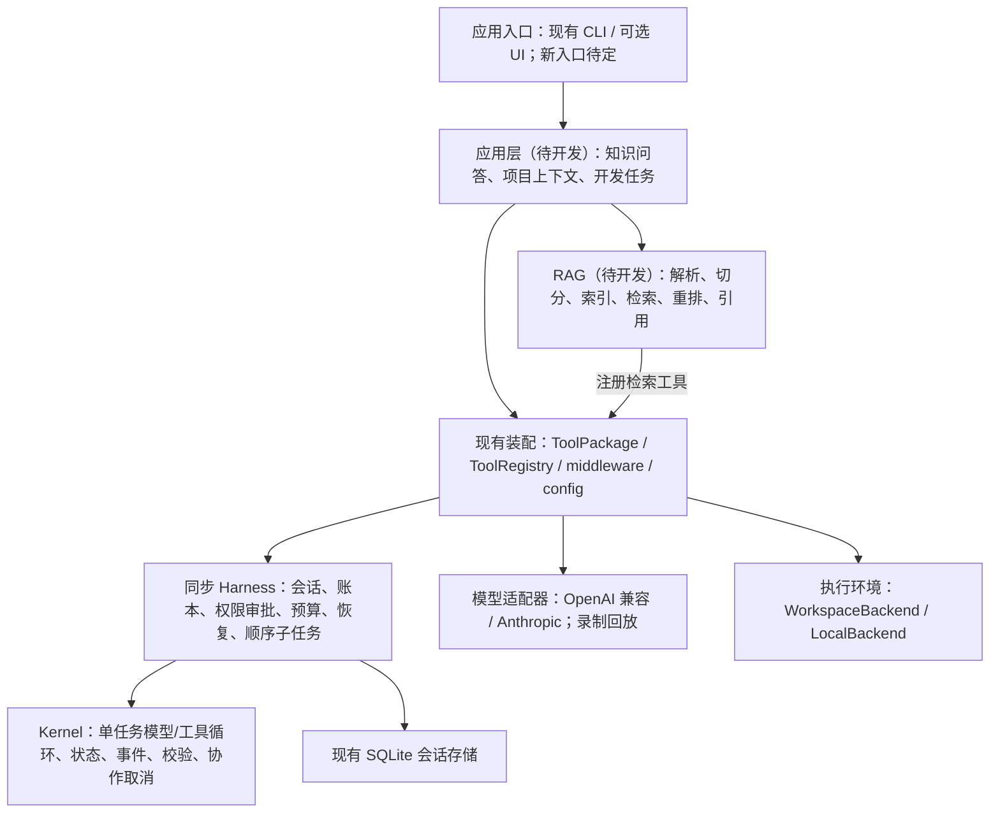

# BaseAgent 应用开发交接

整理日期：2026-10-19。交接前 HEAD 为 `df0107d`，harness 成果基线为 `68fc11f`；新会话必须重新检查分支、工作区和依赖，不能假设仍停留在这些提交。

后续开发更新（2026-10-19）：`ca9f431` 已实现 Phase 1 RAG；Phase 2 已接入 `knowledge_search` 工具包、来源权限/引用核对/脱敏和离线回放。以 [应用 README](applications/project_assistant/README.md) 和 HARNESS_AUDIT.md 最新验收记录为准。本文其余“目录不存在”“RAG 待开发”和待定建议保留为前期交接背景，不表示当前实现状态。

## 1. 项目目标与已经确定的选择

项目首先用于 AI 应用 / Agent 工程岗位的简历与面试。重点是能展示实际应用、解释设计取舍，并用可复现的实验验证可靠性、回答质量和成本。

当前同步 harness 已作为应用开发的阶段基线。下一阶段开发带 RAG 的 Agent 应用，保留已有 coding 能力；框架按真实应用需求改进，不继续按通用框架清单扩张。

最初暂定 coding agent，已有 coding CLI 是实际成果。最近讨论了个人 assistant，建议收敛为“面向个人开发者的知识与项目助理”，将项目知识检索、上下文恢复和受控 coding 串起来。这是应用方向建议，尚未确认完整产品规格、具体知识库、模型服务、embedding/索引技术和新界面。

Dots、Grok Bot 仅作为产品形态的参考；当前没有要求实现其云电脑、多端通信或全天后台执行能力。

## 2. 整体架构



图中框架模块已实现，应用与 RAG 方框为规划。LLM 和 backend 通过模型/工具协议由宿主装配；图中的连接不表示 kernel 导入具体实现。

| 层 | 职责与边界 | 当前入口 |
| --- | --- | --- |
| Kernel | 运行一个任务；不包含业务、数据库、模型 SDK 或后台调度 | `src/baseagent/kernel/` |
| 同步 Harness | 会话事务、工具账本、审批、预算、恢复、顺序嵌套委派和完成验收 | `agent/`、`session/` |
| 能力装配 | 组合工具包、加载本地 skill，登记版本与恢复契约 | `capabilities/`、`config.py` |
| 模型与中间件 | 消息/工具映射、usage、标准错误、重试、共享速率限制 | `llm/`、`middleware/` |
| 工具与执行环境 | 文件/命令/计划/验证/记忆；路径、权限及环境身份 | `tools/`、`backends/` |
| 测试设施 | 模型录像、脱敏、严格离线回放与事件/状态比较 | `testing/`、`tests/`、`scripts/` |
| 新应用与 RAG | 业务数据、文档入库、检索、证据与应用评测 | 尚未创建 |

Kernel 的直接依赖只允许自身、标准库以及 `kernel/tools.py` 中的 jsonschema。整个发行包并非只有 jsonschema 依赖，也尚未拆成多个发行包。

## 3. 已经可以复用的能力

- `baseagent.agent.run_agent(model, user_input, *, tools, ...)`：兼容的同步入口，返回 State；可配置 SessionStore、workspace_root、middleware、预算及策略。没有新 prompt 时可按原契约恢复未完成轮次。
- `baseagent.kernel.iter_agent(model, state, *, tools, hooks=(), cancellation=None)`：迭代入口；消费到结束后检查传入状态。现有同步外壳经该内核执行，不应另外写一套循环。
- `baseagent.capabilities.ToolPackage(name, version, install)` 与 `assemble_capabilities(workspace, packages=..., extensions=..., skills=...)`：应用注册业务工具的现成接入点。内置包为 coding、memory、shared-memory；装配工具不等于授予权限。
- `baseagent.llm.OpenAICompatModel`、`AnthropicModel`：库级适配器；旧 Model 构造及预算接口保留。CLI/config 尚未新增这两个适配器的统一选择配置。
- `RetryMiddleware` 与 `RateLimitMiddleware`：推荐重试在外、限流在内，每次实际尝试重新获取速率额度，并经过原预算检查/记账。先注册的 middleware 位于外层。RateLimiter 可以跨任务共享。
- `CassetteModel`：默认离线 replay；record 显式开启。完整请求摘要匹配，调用过多/不足、参数变化、损坏/版本错误明确失败。模型响应被回放，工具仍会实际执行，不能将有副作用的工具回放当成无副作用操作。
- 现有 coding 工具：读文件/搜索、原子编辑、计划、执行命令、验证与 git diff。完成状态和计划勾选不能替代实际验收证据。
- 现有记忆：会话历史、私有笔记和显式发布的共享参考笔记；shared_memory 不是文档向量检索库。

构造参数、关闭资源方式和完整调用示例以 README 与源码为准。应用应先使用显式 Python 装配；没有实际重复需求时，不新增 IoC 容器或另一套 registry。

## 4. 应用建议与第一版范围（待实施确认）

建议围绕同一个项目完成三个用户场景：

1. 理解项目：检索设计文档与代码，解释某个机制，并展示可定位的来源。
2. 恢复进度：整理已记录目标、历史进展、当前代码事实和待办；区分历史陈述与当前证据。
3. 推进任务：根据相关资料执行一次用户授权的代码修改，运行实际检查，再整理产物与失败原因。

第一个可验收闭环优先做“项目资料入库 → 检索 → 带引用回答 → 受控 coding 任务”。完整项目管理、自动提醒和长期后台执行不必同时交付。

建议新应用独立放在 `applications/project_assistant/`；这是建议目录，目前不存在。可包含以下职责，先按实际复杂度选择模块，不必一次性创建空架子：

```text
applications/project_assistant/       # 建议的新应用位置
  app.py                             # 应用装配与入口
  config.py                          # 应用配置；不存凭据
  rag/                               # 入库、切分、索引、检索与引用
  tools.py                           # knowledge_search 等应用工具
  project_state.py                   # 若首版需要，保存目标/进度等业务事实
  evaluation/                        # 问题集、证据标注、评测入口及实验配置
```

不要为此直接改 kernel。若产生跨应用可复用的稳定检索能力，再讨论提取到框架外层包。

### RAG 数据与调用链

入库：显式授权的文档/源码 → 解析与结构化元数据 → 切分 → 内容摘要与版本 → 检索索引。

查询：问题 → 检索候选 → 可选重排 → 上下文预算 → 返回证据 → 模型回答 → 引用和答案验收。

建议 `knowledge_search` 返回结构化证据：文档/片段 ID、来源、行号或章节、文档版本/内容摘要、片段文本及可用的检索分数。分数含义由具体检索实现定义，不把不同系统分数直接比较。

文档和检索文本作为不可信参考数据，不升级为系统指令。来源权限与业务数据存储由应用负责，不能因为接入 RAG 放宽现有工具权限。切分索引不是权威项目状态；笔记、历史会话与当前源码也不能混为同一事实来源。

若知识库仍未指定，可以先用 BaseAgent 的公开文档及选定源码做本地原型；这只是可撤销的默认方案。排除 `.env`、密钥、`.git/`、`.baseagent/`、私有录像及未授权文件，不默认索引整个用户目录。

### 评测与调优

先固定语料版本、模型/提示词和一批带参考答案、证据位置的问题，区分调优集与最终测试集。可从约 30～50 个问题起步，覆盖精确标识符、概念解释、跨文件证据、无答案以及过期资料。

- 检索：标注证据的 Recall@k；有排序标注后再使用 MRR/nDCG。
- 回答：正确性、引用是否支持结论、无证据时的拒答；初期保留人工核验。
- 成本：端到端延迟、输入/输出 tokens、实际模型尝试数；未知 usage 单列。
- 执行：coding 任务是否通过外部验收、是否发生未授权或重复副作用。

按切分、稀疏/向量/混合检索、重排、top-k 与上下文预算逐项实验。它们是候选实验，不表示已选择某个模型/数据库，也不表示每项都必须首版实现。固定模型响应的回放用于流程回归；真实检索/回答质量需要另外评测，不能拿回放通过率当质量提升。

## 5. 验收证据、限制与后置项

最近一次全量验收为 2026-10-10：462 项全部通过，无跳过，196.201 秒。记录位于 HARNESS_AUDIT.md，本地日志 `.baseagent/harness-checkpoint-tests.log`；本次整理文档未重跑代码验收。历史通过不能替代后续改动后的复验，也不应固定测试数量。

三个真实 DeepSeek 合成录像已入库，来源为六次实际请求：直接回答、一次加法工具、工具错误后纠正；均已通过脱敏与断网回放。Anthropic 只有本地 HTTP 契约测试证据。wheel 构建、81 个 Python 源文件字节核对及公共 API 导入曾通过。

重要边界：

- 当前是同步 harness；同一会话串行执行，子任务是顺序嵌套委派。并行子任务的共享预算需要原子准入/预留，不能直接套线程池。
- RateLimiter 限制请求速率，不限制最大在途请求数；模型并发准入尚未实现。
- 同步网络调用依赖有限传输超时与协作取消，不保证强行终止已发出的 HTTP 请求。
- 估算 token 预算允许最后一次请求超额，随后停止；未知用量需要核验。严格模式没有紧致可信的 DeepSeek 完整请求输入计数器。
- LocalBackend 不是 OS 沙箱。WSL/Docker、常驻 runtime、Redis、消息队列、分布式执行均未实现。
- kernel 的最小依赖干净环境验证、长期压力测试与生产可用性尚无完整证据。微基准只测框架开销。

后台提醒/离开聊天后继续工作确有需求时，才补最薄 runtime；到时区分调度任务状态与现有会话状态。Redis 可作为未来缓存/共享配额实现，消息队列可作为调度适配，均不进入 kernel，也不构成首版 RAG 的必要依赖。

## 6. 新会话工作顺序与约定

1. 阅读本文、ARCHITECTURE.md、README.md 和相关源码；核对 git 状态、当前测试与依赖。HARNESS_PLAN.md、HARNESS_AUDIT.md 保留大量历史，优先看最新记录。
2. 明确第一版应用验收场景与语料范围，再确定检索/embedding/存储方案。新依赖或重大边界变更按现有约定先说明并确认，不能将本交接中的建议当成已获授权的依赖选择。
3. 开发前运行现有全量基线；失败先定位，不删除断言换取通过。先做一个最小闭环，用实际问题驱动公共接口调整。
4. 功能改动运行对应专项和全量回归，区分假模型、本地 HTTP、断网回放与真实 API 证据；新增付费调用另按实际用户授权执行，不因 `.env` 存在而自动调用。
5. 完成后更新文档与验收记录，检查敏感信息和 diff。用户已于 2026-10-18 持续授权：开发和验证完成后默认提交并推送 GitHub 当前分支的既有远端，无需逐次确认；合并、tag、强推另需授权。

常用验证入口：

```powershell
.\.venv\Scripts\python.exe -B -m unittest discover -s tests -v
.\.venv\Scripts\python.exe -B scripts/demo_replay.py
git diff --check
```

现有文档入口：README.md（API/用法）、ARCHITECTURE.md（边界/路线/开发约定）、HARNESS_AUDIT.md（证据与限制）、PERFORMANCE.md（指标及微基准）、SUBTASK_DESIGN.md（顺序子任务契约）。

## 7. 可复制的新会话开场提示词

> 请接续 BaseAgent 的应用层开发。先阅读 DEVELOPMENT_HANDOFF.md、ARCHITECTURE.md、README.md，并检查当前分支、工作区及相关源码。
>
> 我的目标是用于 AI 应用 / Agent 工程岗位的简历项目。当前 harness 已作为基线，已有 coding CLI；下一步希望加入 RAG。最近讨论的应用建议是面向个人开发者的知识与项目助理，保留 coding 能力。请先把首版收敛到项目资料检索、带引用回答与一次受控 coding 任务，不顺带实现完整个人助理、云电脑或全天后台调度。
>
> 先确认语料范围与首版验收场景，再提出最小实施方案和依赖选择。知识库未指定时可以用本仓库公开文档和选定源码做原型，排除凭据、运行数据和私有目录。复用现有 ToolPackage、模型协议和 run_agent，不重写执行循环，不将 RAG 或业务状态放进 kernel。
>
> 开发前跑当前全量基线。按开发集/测试集分离建立小规模问题集，保留检索证据，衡量回答质量、延迟、tokens 和实际任务验收；不编造优化结果。新依赖、重大边界变化和付费模型调用先说明并取得相应授权，其余已授权工作连续完成。开发验证后更新文档，默认提交并推送 GitHub，无需再次确认提交或推送。
