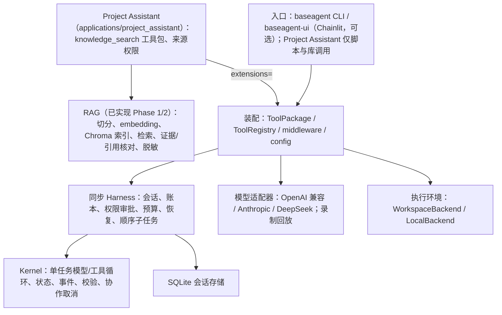

# BaseAgent 应用开发交接

整理日期：2026-10-19。对应 `master` HEAD `e4b4437`（2026-10-19 11:38 UTC+8，“Add verified knowledge search tool package for Project Assistant”）。harness 成果基线为 `68fc11f`。新会话必须重新检查分支、工作区和依赖，不能假设仍停留在这些提交。

本版重写了现状部分，使之与 HEAD 代码一致；旧版中“`applications/project_assistant/` 不存在”“RAG 待开发”等说法已经过期，已删除。仍然有效的目标、边界、评测方法和工作约定予以保留。

## 1. 项目目标与已经确定的选择

项目首先用于 AI 应用 / Agent 工程岗位的简历与面试。重点是能展示实际应用、解释设计取舍，并用可复现的实验验证可靠性、回答质量和成本。

同步 harness 是应用开发的阶段基线。当前阶段开发带 RAG 的 Agent 应用，保留已有 coding 能力；框架按真实应用需求改进，不继续按通用框架清单扩张。

已有 coding CLI 是第一个实际成果。应用方向为“面向个人开发者的知识与项目助理”（Project Assistant），把项目知识检索、上下文恢复和受控 coding 串起来。Phase 1/2 已采用 ChromaDB 向量索引和 OpenAI embedding 接口（另有确定性 Mock）；完整产品规格、新界面以及真实 embedding 的效果尚未确认。

Dots、Grok Bot 仅作为产品形态的参考；当前没有要求实现其云电脑、多端通信或全天后台执行能力。

## 2. 整体架构（HEAD 现状）



LLM 和 backend 通过模型/工具协议由宿主装配；图中的连接不表示 kernel 导入具体实现。默认 `baseagent` CLI 尚未装配 Project Assistant（`--tool-package` 只接受 `coding`、`memory`、`shared-memory`）。

| 层 | 职责与边界 | 代码位置 |
| --- | --- | --- |
| Kernel | 运行一个任务；不包含业务、数据库、模型 SDK 或后台调度 | `src/baseagent/kernel/` |
| 同步 Harness | 会话事务、工具账本、审批、预算、恢复、顺序嵌套委派和完成验收 | `src/baseagent/agent/`、`session/` |
| 能力装配 | 组合工具包、加载本地 skill，登记版本与恢复契约 | `capabilities/`、`config.py` |
| 模型与中间件 | 消息/工具映射、usage、标准错误、重试、共享速率限制、token 估算与预留 | `llm/`、`middleware/` |
| 工具与执行环境 | 文件/命令/计划/验证/记忆；路径、权限及环境身份 | `tools/`、`backends/` |
| 宿主 | CLI、可选 Chainlit UI、离线 harness 评估 | `main.py`、`ui/`、`evaluation.py` |
| 测试设施 | 模型录像、脱敏、严格离线回放与事件/状态比较 | `testing/`、`tests/`、`scripts/` |
| 应用与 RAG | 语料、切分、索引、检索、证据、来源权限、`knowledge_search` | `applications/project_assistant/` |

Kernel 的直接依赖只允许自身、标准库以及 `kernel/tools.py` 中的 jsonschema。整个发行包并非只有 jsonschema 依赖（见 `pyproject.toml`：deepagents、langchain-openai、openai、pydantic-settings、python-dotenv、tokenizers、chromadb、anthropic），也尚未拆成多个发行包。`applications/` 不在 wheel 内，只能从仓库 checkout 运行。

## 3. 已经可以复用的能力

框架（`src/baseagent/`）：

- `baseagent.agent.run_agent(model, user_input, *, tools, ...)`：兼容的同步入口，返回 State；可配置 SessionStore、workspace_root、middleware、预算及策略。没有新 prompt 时可按原契约恢复未完成轮次。
- `baseagent.kernel.iter_agent(model, state, *, tools, hooks=(), cancellation=None)`：迭代入口；消费到结束后检查传入状态。同步外壳经该内核执行，不应另外写一套循环。
- `baseagent.capabilities.ToolPackage(name, version, install)` 与 `assemble_capabilities(workspace, packages=..., extensions=..., skills=...)`：应用注册业务工具的接入点。内置包为 coding、memory、shared-memory；装配工具不等于授予权限。
- `baseagent.llm.OpenAICompatModel`、`AnthropicModel`：库级适配器；CLI/config 尚无这两个适配器的统一选择配置，CLI 仍只用 `DEEPSEEK_*` 环境变量。
- `RetryMiddleware` 与 `RateLimitMiddleware`：推荐重试在外、限流在内；先注册的 middleware 位于外层；RateLimiter 可以跨任务共享。
- `CassetteModel`：默认离线 replay（`BASEAGENT_CASSETTE_MODE`），record 需显式开启。模型响应被回放，工具仍会实际执行。
- coding 工具：读文件/搜索、原子编辑、计划、执行命令、验证与 git diff。完成状态和计划勾选不能替代实际验收证据。
- 记忆：会话历史、私有笔记和显式发布的共享参考笔记；shared_memory 不是文档向量检索库。
- 配置：`--config` 读取 version 1 严格 JSON（示例 `examples/harness.readonly.json`、`examples/harness.coding.json`）。

应用（`applications/project_assistant/`，Phase 1 = `ca9f431`，Phase 2 = `e4b4437`）：

- `rag/chunking.py`：Markdown 按标题层级切分，Python 按函数/类切分。
- `rag/embedding.py`：`OpenAIEmbedding`（读 `OPENAI_API_KEY`，默认 `text-embedding-3-small`，维度固定为 1536）与确定性 `MockEmbedding`。
- `rag/indexing.py`：`VectorIndex`（ChromaDB，可持久化）；`rag/retrieval.py`：`Evidence` 与 `retrieve`。
- `corpus.py`：`collect_corpus`、`compute_corpus_version`（包含路径与行号）、`save_corpus_metadata`。
- `config.py`：`RAGConfig.from_env()` 读取 `RAG_EMBEDDING_PROVIDER`、`OPENAI_API_KEY`、`RAG_EMBEDDING_MODEL`、`RAG_INDEX_DIR`、`RAG_COLLECTION_NAME`。
- `access.py`：`SourceAccess(workspace, include_patterns, exclude_patterns)`，默认允许 `*.md`、`*.py`，强制排除隐藏目录、凭据、路径穿越、链接与 junction。
- `tools.py`：`knowledge_package(index, access, corpus_version=...)` 注册 `knowledge_search(query, top_k=5)`；返回前核对引用行与片段摘要并脱敏；结果带 `evidence`、`corpus_version`、`reference_only`。
- 脚本：`scripts/build_knowledge_base.py`、`scripts/query_knowledge_base.py`（均支持 `--mock-embedding`）、`scripts/demo_knowledge_search.py`（离线演示）。注意这些脚本不调用 `load_dotenv()`。

构造参数、关闭资源方式和完整调用示例以 README、应用 README 与源码为准。应用先使用显式 Python 装配；没有实际重复需求时，不新增 IoC 容器或另一套 registry。

## 4. 应用验收场景与进度

| 场景 | 内容 | 状态（HEAD） |
| --- | --- | --- |
| 1. 理解项目 | 检索设计文档与代码，解释某个机制，展示可定位来源 | 检索与引用机制已实现，仅有 Mock embedding 与合成模型的离线证据；真实检索/回答质量未评测 |
| 2. 恢复进度 | 整合文档与 git 历史，区分历史陈述与当前证据 | 未实现：语料只含文件，`.git` 被排除 |
| 3. 推进任务 | 根据资料执行一次授权的代码修改，运行检查，汇报产物与失败原因 | 未实现：coding 工具已有，但没有结合检索的端到端场景 |

后续计划见 `PHASE3_PLAN.md`：P0 真实 embedding 检索评测 → P1 Project Assistant CLI 入口、受控 coding 场景 → P2 git 历史进度恢复。应用 README 中列出的后续优化方向（混合检索、chunk 预算、增量索引、重排、评测框架）均未实现。

### RAG 数据与调用链（已实现部分）

入库：授权的文档/源码 → 切分（附带路径、行号、章节/函数名）→ 语料版本 → Chroma 索引。

查询：问题 → 检索 `top_k * 4` 个候选 → 可见性过滤 → 引用/摘要核对 → 脱敏 → 返回证据 → 模型回答。可选重排与上下文预算尚未实现。

文档和检索文本作为不可信参考数据，不升级为系统指令；Phase 2 没有宣称解决语义层的提示词注入。`SourceAccess` 与 coding 的 `ToolPolicy` 相互独立，宿主需配置一致的范围。索引不是权威项目状态；笔记、历史会话与当前源码不能混为同一事实来源。重新入库后需要用新的语料版本重新构造工具包，禁止静默替换索引。

### 评测与调优（方法仍有效，尚未执行）

先固定语料版本、模型/提示词和一批带参考答案、证据位置的问题，区分调优集与最终测试集。可从约 30～50 个问题起步，覆盖精确标识符、概念解释、跨文件证据、无答案以及过期资料。

- 检索：标注证据的 Recall@k；有排序标注后再使用 MRR/nDCG。
- 回答：正确性、引用是否支持结论、无证据时的拒答；初期保留人工核验。
- 成本：端到端延迟、输入/输出 tokens、实际模型尝试数；未知 usage 单列。
- 执行：coding 任务是否通过外部验收、是否发生未授权或重复副作用。

固定模型响应的回放用于流程回归；真实检索/回答质量需要另外评测，不能拿回放通过率当质量提升。

## 5. 验收证据、限制与后置项

- 应用 README 记录：Phase 2 后全量回归 497 项全部通过（235.373 秒），其中 RAG 35 项；演示 7 项检查通过。
- 本次整理复验（2026-10-19，Linux，Python 3.13.5，venv + `pip install -e .`，在仓库副本中运行）：`python -B -m unittest discover -s tests` 共 497 项，OK（54.6 秒）；`test_rag*.py` 35 项，OK；`baseagent --eval-harness` 离线场景全部 passed；`scripts/demo_knowledge_search.py` 与 Mock 入库/查询脚本运行成功（入库 1916 个 chunk）。未在 Windows 上复验，也没有发起真实 API 调用。
- 三个真实 DeepSeek 合成录像已入库（六次实际请求），通过脱敏与断网回放。Anthropic 只有本地 HTTP 契约测试证据。
- 历史通过不能替代后续改动后的复验，也不应固定测试数量。

重要边界（仍有效）：

- 同步 harness；同一会话串行执行，子任务是顺序嵌套委派。并行子任务的共享预算需要原子准入/预留。
- RateLimiter 限制请求速率，不限制最大在途请求数；模型并发准入尚未实现。
- 同步网络调用依赖有限传输超时与协作取消，不保证强行终止已发出的 HTTP 请求。
- 估算 token 预算允许最后一次请求超额，随后停止；未知用量需要核验。
- LocalBackend 不是 OS 沙箱。WSL/Docker、常驻 runtime、Redis、消息队列、分布式执行均未实现。
- kernel 的最小依赖干净环境验证、长期压力测试与生产可用性尚无完整证据。
- RAG：`OpenAIEmbedding` 维度固定为 1536 且不支持自定义 `base_url`；脱敏是尽力过滤；索引磁盘内容不会因出口脱敏而被清洗。

后台提醒/离开聊天后继续工作确有需求时，才补最薄 runtime。Redis、消息队列均不进入 kernel，也不是 RAG 的必要依赖。

## 6. 新会话工作顺序与约定

1. 阅读本文、ARCHITECTURE.md、README.md、`applications/project_assistant/README.md` 和相关源码；核对 git 状态、当前测试与依赖。HARNESS_PLAN.md、HARNESS_AUDIT.md 保留大量历史，优先看最新记录。
2. 按 `PHASE3_PLAN.md` 的优先级推进。新依赖或重大边界变更先说明并确认。
3. 开发前运行全量基线；失败先定位，不删除断言换取通过。
4. 功能改动运行对应专项和全量回归，区分假模型、本地 HTTP、断网回放与真实 API 证据；付费调用需用户另行授权，不因 `.env` 存在而自动调用。
5. 完成后更新文档与验收记录，检查敏感信息和 diff。用户已于 2026-10-18 持续授权：开发和验证完成后默认提交并推送到 GitHub 当前分支的既有远端，无需逐次确认；合并、tag、强推另需授权。

常用验证入口（PowerShell；bash 把 `.\.venv\Scripts\python.exe` 换成 `.venv/bin/python`）：

```powershell
.\.venv\Scripts\python.exe -B -m unittest discover -s tests -v
.\.venv\Scripts\python.exe -B -m unittest discover -s tests -p "test_rag*.py" -v
.\.venv\Scripts\python.exe -B scripts/demo_replay.py
.\.venv\Scripts\python.exe -B scripts/demo_knowledge_search.py
git diff --check
```

现有文档：README.md（API/用法）、ARCHITECTURE.md（边界/路线/开发约定）、applications/project_assistant/README.md（RAG 现状）、HARNESS_AUDIT.md（证据与限制）、HARNESS_PLAN.md（历史计划）、PERFORMANCE.md（指标与微基准）、SUBTASK_DESIGN.md（顺序子任务契约）。

## 7. 可复制的新会话开场提示词

> 请接续 BaseAgent 的 Project Assistant 开发。先阅读 DEVELOPMENT_HANDOFF.md、PHASE3_PLAN.md、ARCHITECTURE.md、README.md、applications/project_assistant/README.md，并检查当前分支、工作区及相关源码。
>
> 目标是用于 AI 应用 / Agent 工程岗位的简历项目。harness 已作为基线；RAG Phase 1（切分/索引/检索）与 Phase 2（knowledge_search、来源权限、引用核对、脱敏、离线回放）已完成。下一步按 PHASE3_PLAN 推进：先做真实 embedding 的检索评测，再做应用 CLI 入口和受控 coding 场景，最后做 git 历史进度恢复。不顺带实现完整个人助理、云电脑或全天后台调度。
>
> 复用现有 ToolPackage、模型协议和 run_agent，不重写执行循环，不把 RAG 或业务状态放进 kernel。开发前跑全量基线；评测区分调优集/测试集，如实记录检索指标、回答质量、延迟、tokens，不编造结果。新依赖、重大边界变化和付费模型调用先说明并取得授权；开发验证后更新文档，默认提交并推送 GitHub。
