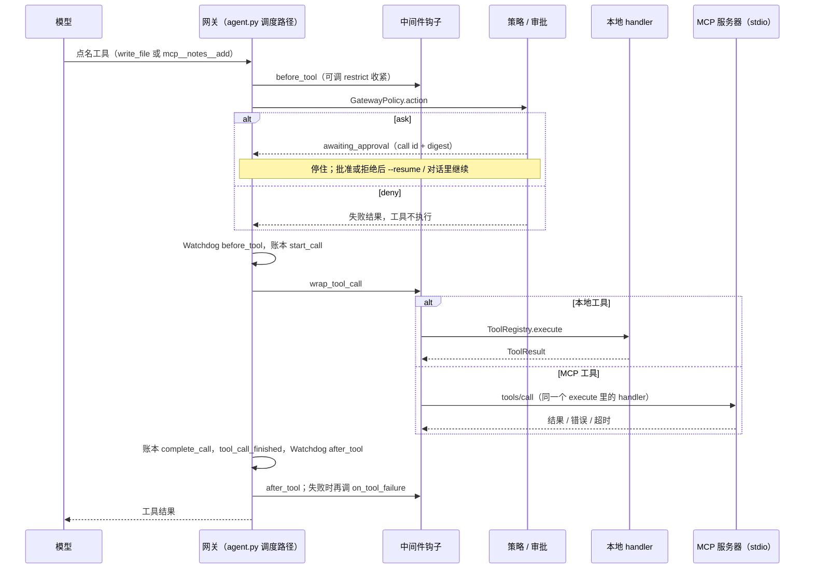

# MCP 客户端与工具网关

BaseAgent 可以把 stdio MCP 服务器提供的工具接进来。接进来的工具和内置工具走同一条调度路径：同一个 `ToolRegistry`、同一套策略、审批、账本和中间件钩子。BaseAgent 只是 MCP **客户端**，不对外提供 MCP 服务。

不配置 MCP 时这部分完全不启动，工具列表、会话契约和已有行为都不变。

## 网关和客户端的关系

「工具网关」不是新的循环，也不是新的包。它就是 `agent/agent.py` 里原有的调度路径，加上三样东西：

- `ToolRegistry` 记下每个工具由谁执行（`origin(name)` 返回 `("local", None)` 或 `("mcp", "<server>")`）；
- `agent/gateway.py` 的 `GatewayPolicy`，包在原有策略链最外层；
- `AgentMiddleware` 上新增的两个收尾钩子 `after_tool`、`on_tool_failure`。

MCP 客户端（`baseagent/mcp/`）只负责「启动进程、握手、列工具、发一次 `tools/call`」。它不判断能不能调，也不会被模型适配器直接使用：`tools/call` 只从注册进 Registry 的 handler 里发出，而 handler 只认 harness 调度传进来的上下文（有 call id 和策略），别处调用一律 `permission_denied`。



顺序和以前一样，只多了最后一步的两个钩子。

## 配置

两个来源，有 flag 时 flag 优先：

1. `--mcp-config path`
2. 工作区根目录（`--root`）下的 `.mcp.json`

两个都没有就是关闭。`--mcp-config` 指向不存在的文件直接退出（退出码 2）。

```json
{
  "mcpServers": {
    "notes": {
      "command": "python",
      "args": ["tools/notes_server.py"],
      "env": {"NOTES_DIR": "/tmp/notes"},
      "timeout": 60,
      "tools": {
        "search": {"readOnly": true}
      }
    }
  }
}
```

| 字段 | 说明 |
| --- | --- |
| `command` / `args` | 原样执行，不经过 shell，不展开 `${VAR}`，不自动安装。工作目录是工作区根目录 |
| `env` | 叠加在当前环境变量上。值可能是密钥：只参与哈希，不写入会话库、事件和日志 |
| `timeout` | 单次 `tools/call` 的秒数上限，默认 60 |
| `tools.<名字>.readOnly` | 声明这个工具没有副作用，见下面「只读与默认 ask」 |

服务器名只能用字母、数字和连字符（1–32 个字符）。带 `url` 或 `type` 不是 `stdio` 的条目会被跳过并提示：本支只做 stdio。

BaseAgent 不会替你装服务器，也不会默认去跑要联网的 `npx` 包；写了什么命令就跑什么命令。

**注意信任边界**：`.mcp.json` 放在工作区里，里面写的命令会在这台机器上运行。所以项目自带的 `.mcp.json` 第一次用之前要先确认，见下面「首次信任」。启动时每个服务器都会在 stderr 打一行 `MCP: starting server '<名字>' from <文件>: <命令>`。

## 首次信任

只管工作区根目录的 `.mcp.json`（项目带来的配置）。`--mcp-config PATH` 是你自己点名的配置，不问、不记，行为与以前一致；没有 `.mcp.json` 的项目也与以前逐字一致。

**交互模式第一次用：** CLI 对话、`--ui tui`、`--ui web`（在界面起来之前，用启动它的那个终端问）在 stdin 是终端时，先在 stderr 列出要启动的服务器，再问一次：

```text
MCP: this project's .mcp.json (/repo/.mcp.json) wants to start 1 server(s):
  - notes: ["python", "tools/notes_server.py"]
      env keys: NOTES_DIR (values not shown)
Trust this .mcp.json and start these servers? [y/N]
```

- 列的是名字、命令、参数和 `env` 的**键名**；`env` 的值不显示、不存。
- 答 `y` 之前一个服务器进程都不起。答 `y`：记下信任，照常启动；以后同一个文件不再问。
- 答别的（或 EOF / Ctrl+C）：本次会话照常运行，只是没有 MCP 工具；stderr 提示以后怎么再信任（下次进对话答 `y`，或 `baseagent --root <目录> --mcp-trust`）。拒绝不会被记住，下次还会问。

**信任记在哪：** 用户配置目录下的 `mcp-trust.json`，不在任何工作区里：

| 平台 | 位置 |
| --- | --- |
| 设了 `BASEAGENT_CONFIG_HOME` | `$BASEAGENT_CONFIG_HOME/mcp-trust.json` |
| Linux / macOS | `$XDG_CONFIG_HOME/baseagent/mcp-trust.json`，没设时 `~/.config/baseagent/mcp-trust.json` |
| Windows | `%APPDATA%\baseagent\mcp-trust.json` |

```json
{"version": 1, "projects": {"/repo/.mcp.json": {"sha256": "<整个文件字节的 SHA-256>", "servers": ["notes"], "trusted_at": "2026-11-13T08:30:00+00:00"}}}
```

- 键是 `.mcp.json` 的真实路径（解析符号链接后），值是整个文件字节的哈希。文件任何一个字节变了（包括 `env` 的值、空格），旧信任就失效，下次重新问，并说明「changed since you trusted it」。
- 仓库自带的「已信任」记录不算数：BaseAgent 只读用户配置目录；如果 `BASEAGENT_CONFIG_HOME` 指到了工作区里面，这个信任库对该工作区直接作废（stderr 说明原因，不启动、不问）。
- 列给你看、算哈希、最后启动的是同一份字节：先读一次文件，用这份字节解析和哈希，信任后启动的就是这次解析出来的服务器。

**撤销与预先信任：**

```bash
baseagent --root /repo --mcp-trust     # 列出服务器并信任当前这份文件（不调模型、不建会话库、不启动服务器）
baseagent --root /repo --mcp-untrust   # 删除这条信任记录；之后再用会重新问
```

**非交互：** 一次性任务、`--resume`、`--output-format json|jsonl`、stdin 不是终端的对话，一律**不问也不启动**未信任（或改过）的 `.mcp.json`：

- stderr：`MCP: /repo/.mcp.json is not trusted yet; its servers were not started (non-interactive run). to trust it, review … and run: baseagent --root /repo --mcp-trust …`
- json：结果对象多一个可选字段 `"mcp": {"skipped": "untrusted", "config": ".mcp.json", "servers": ["notes"]}`（信任库在工作区里时 `skipped` 是 `store_in_workspace`）；jsonl 的 `result` 行相同。只有服务器名，没有命令和 `env`。已信任或没有 `.mcp.json` 时没有这个键。
- 任务本身照常跑，只是没有 MCP 工具，退出码按任务结果。

**`--mcp-strict`：** 未信任（包括交互时拒绝）按「配置的 MCP 用不了」处理：`MCP error: … is not trusted …`，退出码 2，不调模型；json / jsonl 输出 `status: "error"`、`exit_code: 2`。

## 命名

注册名是 `mcp__<服务器名>__<工具名>`，例如 `mcp__notes__search`。`--tool-policy`、审批提示、账本和事件里用的都是这个名字，所以从名字就能看出是哪个服务器的哪个工具。

- 和已有工具重名（内置工具、应用工具或另一个 MCP 工具）时，跳过这个 MCP 工具并警告，不覆盖。
- 名字里有模型接口不接受的字符（只允许字母、数字、`_`、`-`，最长 64；MCP 允许的 `.` 不行）时跳过并警告，不做改名，保证名字稳定。
- `inputSchema` 不是合法的对象 schema 时跳过并警告。

工具列表在运行或会话开始时取一次（`tools/list`，支持分页），之后不刷新；服务器中途变更工具要重开会话。

## 只读与默认 ask

MCP 工具默认当作有副作用：`retry_safe=False`，不会被重试，也不参与并行只读批次。

| 情况 | 行为 |
| --- | --- |
| `--mode read-only`（默认） | 只暴露配置里标了 `readOnly: true` 的工具，其余不注册，模型看不到 |
| `--mode edit` / `full`，工具未标只读 | 每次调用都停下来等审批（`ask`） |
| 工具标了 `readOnly: true` | 当作只读工具：按策略默认放行，可重试，只读 Worker 也能拿到 |
| `--tool-policy` 写了 `deny` | 不执行 |
| `--tool-policy` 写了 `allow` | 对未标只读的 MCP 工具无效，仍然 `ask` |

最后一行是有意的：策略只能在默认之上再收紧。默认 `ask` 的实现在 `GatewayPolicy`，它取「原策略链的结论」和「MCP 默认 ask」里更严的那个，所以没有任何策略写法能让有副作用的 MCP 工具静默执行。想免审批，只能在配置里声明它 `readOnly`——这是你对这个工具的承诺，BaseAgent 不验证，也不采信服务器自己报的 `readOnlyHint`。

审批沿用原来的机制：call id + 请求 digest，CLI（`Allow mcp__notes__add? [y/N]`、`--approve-tool`）、TUI 弹窗、Web `/approvals` 共用。批准只对这一次调用有效，参数相同的下一次调用会再问。digest 对不上不能批。

## 会话与 Worker

- 运行时契约包含每个在用服务器的配置哈希。未完成的会话新增、删除或更换服务器（包括某个服务器这次没启动成功），续跑需要 `--accept-config-changes`；换过服务器后，之前记下的批准作废，会重新询问。
- Worker 拿到的 MCP 工具跟内置工具同一条规则：没有写权限的 Worker 只有标了 `readOnly` 的工具，可写 Worker 拿到全部；有副作用的调用照样在对话里逐条审批。「同时只有一个可写 Worker」不变。
- **检查点 / `/undo` 只管 `write_file`、`edit_file` 和 `apply_patch`（含它的 `delete`）写过的文件。MCP 工具在外部造成的任何改动都撤不回。**

## 进程生命周期

- 启动：一次性运行、`--resume` 或进入对话时，逐个启动配置里的服务器，`initialize` → `notifications/initialized` → `tools/list`，启动阶段每步最多等 10 秒。
- 失败：命令起不来、`initialize` 或 `tools/list` 失败、进程启动即退出，默认跳过这个服务器，在 stderr 写明原因（附服务器 stderr 的一小段），其它服务器和本地工具照常。加 `--mcp-strict` 则任何一个服务器或工具用不了都直接退出，退出码 2，不调模型。
- 调用：每次 `tools/call` 受三样东西约束——配置的 `timeout`、本轮剩余时限、取消信号（Ctrl+C、`/cancel`、`--cancel-session`）。到点或被取消就返回 `timeout` / `cancelled` 失败结果，并给服务器发 `notifications/cancelled`。协议错误、非 JSON 输出、JSON-RPC 错误、调用中途进程退出，都是失败结果，不会把异常抛出内核循环。服务器进程退出后，它的工具之后每次调用都立刻失败，不会重启。
- 服务器的 stderr 只当日志：持续读走，最多保留 20000 字节（和命令输出的上限一样），不解析。
- 结束：一次性运行结束、对话退出、出错、Ctrl+C 时，对每个服务器先关 stdin，等 1 秒，再对整个进程组发 SIGTERM，再等 1 秒，最后 SIGKILL 整个进程组（服务器自己派生的子进程一起清掉）。另外注册了 `atexit` 和 SIGTERM 处理作为兜底。BaseAgent 自己被 `kill -9` 时没有机会清理，这时依赖服务器在 stdin 关闭后自行退出。
- 取消一次调用不会结束服务器，只结束这次等待；服务器在会话结束时才停。卡死在某次调用里的服务器，之后的调用会各自超时。

## 钩子：以后怎么接防护

`AgentMiddleware` 现在有四个工具节点：

| 钩子 | 时机 | 能做什么 |
| --- | --- | --- |
| `before_tool(request)` | 策略判定之前 | 观察；调用 `baseagent.agent.gateway.restrict(request, "ask" \| "deny", reason)` 收紧这一次调用 |
| `wrap_tool_call(request, handler)` | 执行前后 | 原有行为不变（可以替换结果，例如 HK 扣下输出） |
| `after_tool(request, result)` | 结果入账之后 | 只观察，每次调用一次，成功失败都调 |
| `on_tool_failure(request, result)` | `after_tool` 之后，仅失败结果 | 只观察；被拒绝、被 BLOCK、超时、崩溃都算 |

`request` 上能读到 `name`、`call_id`、`source`（`local` 或 `mcp`）、`mcp_server_id`（本地工具为 `None`）。

钩子只能加限制。`restrict` 只接受 `ask` 和 `deny`，网关取它和策略结论里更严的一个，所以钩子放宽不了 `--mode`、`--tool-policy`、工作区边界和保护路径。判定和审批仍由 `policy.action` 完成，钩子里没有策略引擎。

本支没有重写 HarnessKnight 和 Watchdog，也没有做新的插件机制。因为调度路径是同一条，开着 `--harness-url` 或 `--watchdog` 时它们的现有实现自动作用在 MCP 工具上：HK 事件的 `trace.mcp_server_id` 填服务器名（本地工具仍是 `null`），REVIEW 走原审批，BLOCK 不执行；Watchdog 的重复、停滞、超时规则照常计数。HK 现有的 `infer_impacts` 不认识 MCP 工具名，对它们返回空列表，规则没有改。

以后要做全流程管控，写一个新的 `AgentMiddleware` 挂进去即可，不要再分叉调用链，也不需要改 MCP 客户端。

元数据事件里，MCP 调用的 `approval_requested`、`tool_call_started`、`tool_call_finished` 多两个字段 `source: "mcp"` 和 `mcp_server_id`；本地工具的事件形状不变（没有这个字段，读作 null）。事件和钩子元数据里不出现参数原文、`env` 值或结果正文。

## 协议范围

实现的是 2025-11-25 版的握手和 stdio 传输：每行一条 UTF-8 JSON-RPC 消息，消息内不含换行。

工具结果同时接受 2026-07-28 版的形状：`resultType` 缺省当作 `complete`；`input_required`（服务器要求补充输入）报告为失败，因为没做 elicitation；`tools/list` 按 `nextCursor` 翻页（最多 20 页、200 个工具）。2026-07-28 版已改为无状态协议（每个请求带 `_meta`，不再握手），本支按计划做 `initialize` 握手，只会无握手协议的服务器连不上，会被当作启动失败跳过。

文本内容（`text`，以及内嵌资源里的文本）拼成 `data.text`，`structuredContent` 放在 `data.structured`；图片、音频、资源链接只留类型和 URI，不把内容塞进上下文。`isError: true` 变成 `execution_failed`，错误文本交给模型。服务器发来的请求（sampling、elicitation、roots）一律回 `-32601`，`ping` 回空结果。单条消息上限 1 MB，超了就断开这个服务器。

## 限制

- 只有 stdio。Streamable HTTP 没做：`mcp/transport.py` 的 `Transport` 协议（`start` / `request` / `notify` / `close`）是留给它的接口，新传输实现这四个方法即可，网关和客户端不用改。
- 不做 resources、prompts、sampling、elicitation、OAuth，不订阅 `tools/list_changed`。
- 不是对外 MCP 服务。
- `/undo` 撤不回 MCP 工具的副作用。
- 工具描述和结果来自服务器，是不可信文本；它们会进入模型上下文。只接你信得过的服务器。
- 没有「对某个有副作用的 MCP 工具始终放行」的写法，见上面的表。
- Windows 上的进程树清理（`taskkill /T`）写了但没有实测。
- `--config` 的 harness 配置文件里没有 MCP 字段，只能用 flag 或 `.mcp.json`。
- 首次信任只在启动前的终端里问；TUI / Web 界面里没有信任对话框，界面起来以后不能再改信任（重开即可）。

## 为什么手写而不是用官方 SDK

- 本支只需要三个方法和一种传输，加上进程管理大约四百行，读得完，能逐行对照规范。
- 项目约定核心运行时不新增依赖。官方 SDK 会带进一串传输、认证和异步运行时相关的包，而这里的 harness 是同步的。
- 超时、取消、进程组清理必须和现有的取消令牌、轮次时限对齐，自己掌握这层更直接。

代价是规范演进要自己跟，HTTP、认证这些功能要自己补。到需要它们的时候再评估是否换成 SDK；`Transport` 接口让这个替换只发生在 `baseagent/mcp/` 里。

## 试一下

```bash
python -B scripts/demo_mcp.py   # 离线，假服务器 + 假模型，费用 0
```

测试在 `tests/test_mcp_client.py`、`tests/test_mcp_gateway.py`、`tests/test_mcp_cli.py`、`tests/test_mcp_trust.py`（首次信任），假服务器是 `tests/fixtures/fake_mcp_server.py`。
