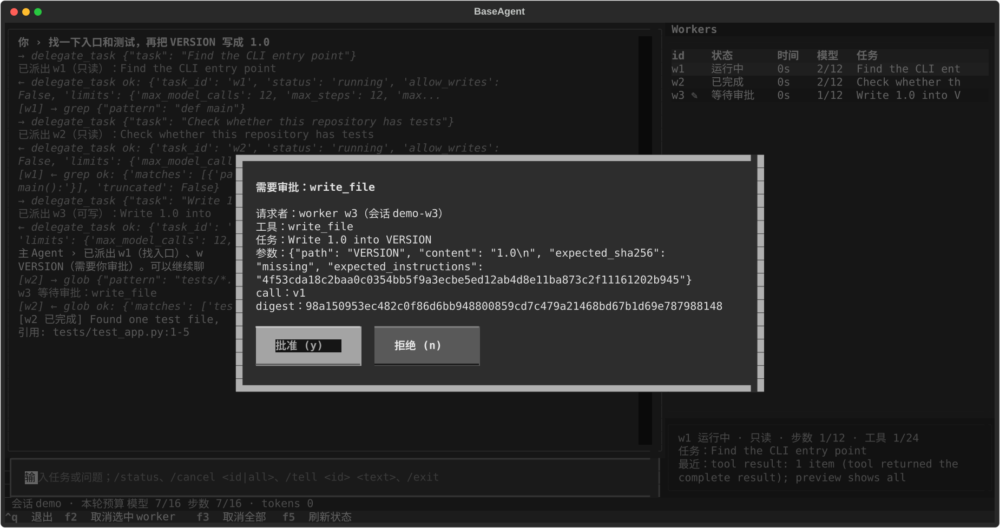
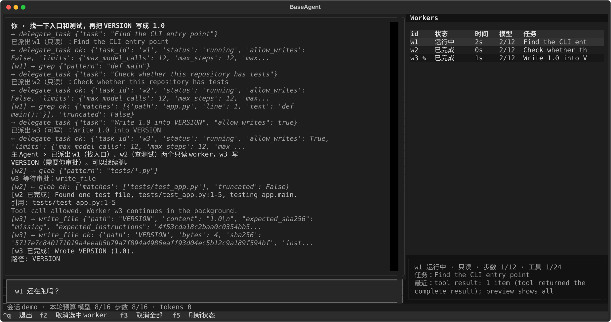

# 连续对话的 TUI 与 Web 前端

连续对话（主 Agent + 后台 Worker，见 [router_worker.md](router_worker.md)）有三个前端：原来的行式 CLI、Textual TUI、本机 FastAPI + SSE 网页。三者共用一层与界面无关的会话/事件层 `baseagent.chat`；内核和 agent 循环没有改，只在 `WorkerManager` 上加了一个只报告、不改控制流的事件钩子。

```bash
uv sync --extra tui        # textual
uv sync --extra web        # fastapi + uvicorn（--extra frontends 两个都装）
baseagent --ui tui --root . --session demo
baseagent --ui web --root . --session demo [--host 127.0.0.1] [--port 8765] [--token ...]
```

`--ui` 是参数而不是子命令，避免和一次性任务的位置参数冲突；它只用于连续对话，和 prompt 或 `--resume` / `--events` 之类的会话操作一起用会被拒绝。连续对话的其他参数（`--session`、`--max-workers`、`--allow-write`、`--allow-command`、`--budget-cny`、`--tool-policy`……）三个前端完全一样，因为它们走的是 `main.py` 里同一段组合代码，只在最后一步把同一个 `ChatSession` 交给不同的前端。没装对应 extra 时打印一行安装提示（`uv sync --extra tui` / `pip install 'baseagent[tui]'`），退出码 2，不抛堆栈。

## 架构

```text
            run_agent（内核 + agent 循环，未改）            WorkerManager（agent/workers.py）
                  │  ToolEventMiddleware（只观察）            │  observer 钩子：worker_* / approval_requested
                  ▼                                            ▼
        ┌──────────────────────── ChatSession（baseagent/chat/session.py）────────────────────────┐
        │ 命令：send / turn · approve / deny / decide · cancel · tell · status · wait · exit       │
        │ 规则：上一轮没完成先续跑；审批按 call_id + digest；/status /wait /cancel /tell 的文字   │
        │ EventBuffer（chat/events.py）：有上限的内存缓冲，id 单调递增，after_id → 事件或 resync │
        └───────────────┬──────────────────────────┬──────────────────────────┬──────────────────┘
                        │ 同步调用 + printer         │ events_after 轮询 50 ms    │ events_after → SSE
                        ▼                            ▼                            ▼
                 cli_chat（行式 CLI）          tui/app.py（Textual）        web/server.py（FastAPI）
                 输出文字与改造前逐字一致       对话区 / Worker 面板 / 弹窗    static/：HTML + 原生 JS + Pico.css
```

- **规则只在 `ChatSession`。** 前端只做三件事：调用命令、显示事件、问 y/N（CLI 用 `input()`，TUI 用弹窗，Web 用卡片按钮）。审批的 call_id / digest 校验、Worker 上限、单写者、共享预算、持久化都在 `ChatSession` 和它下面的 `WorkerManager` / `SessionStore` 里，界面层没有自己的规则。
- **CLI 也跑在这层上。** `cli_chat.run_chat` 现在只读行、打印、问 y/N；回合执行、续跑、审批、`/status /wait /cancel /tell /exit` 都调用 `ChatSession`。CLI 要打印的每一行由 `ChatSession._say` 产出：同时发一个事件，并交给 CLI 的 `printer` 打到 stdout/stderr，所以文字、顺序和流向不变（`tests/test_cli_chat.py`、`tests/test_main_agent.py` 原样通过）。停止原因、审批预览、`/status` 的文字从 `cli_chat` 原样搬到 `chat/text.py`，`cli_chat` 继续导出这些名字。
- **同步与异步。** CLI 直接调用 `turn(text, ask)`，阻塞到这一轮结束。TUI 和 Web 调 `send(text)`：在一个后台线程里跑同一个 `turn`，立即返回；主 Agent 自己的待审批调用用 `approve/deny` 回答后，再在后台线程里 `continue_turn`。同一时间只有一个主 Agent 回合；回合进行中再发消息会被拒绝（`error` 事件，Web 返回 409，输入框保留原文），不排队，理由和 Worker 上限「拒绝不排队」一样。

## 命令

| `ChatSession` | CLI | TUI | Web |
| --- | --- | --- | --- |
| `send(text)` / `turn(text, ask)` | 输入一行 | 输入框回车 | `POST /messages {"text"}` |
| `approve` / `deny(call_id, digest, worker=…)` | `Allow …? [y/N]` | 审批弹窗：批准 (y) / 拒绝 (n) | `POST /approvals {"call_id","digest","decision","worker"?}` |
| `cancel(id \| "all")` | `/cancel <id\|all>` | F2 取消选中 / F3 全部 / `/cancel` | `POST /workers/{id}/cancel`（`id=all` 取消全部） |
| `tell(id, text)` | `/tell <id> <text>` | `/tell` | `POST /workers/{id}/tell {"text"}` |
| `status()` / `status_lines()` | `/status` | F5、状态栏、Worker 面板 | `GET /status`、`status` 事件 |
| `exit(force=False)` | `/exit`，有 Worker 在跑先问 c/w | Ctrl+Q，同样先问 | 终端 Ctrl+C 停服务（运行中的 Worker 记为取消） |

审批时 call_id 或 digest 和当前待审批的调用对不上就拒绝（`ApprovalMismatch`，Web 返回 409），和 CLI 一样只作用于显示出来的那一个调用。`worker` 参数可以把匹配限定到某个 Worker，`null` 表示主 Agent 自己的调用。

## 事件

每个事件是 `{"id": n, "kind": "...", "ts": 秒, "data": {...}}`。`id` 在一个 `EventBuffer`（也就是一个进程里的一个会话）内从 1 开始单调递增。

| 类型 | 字段（data） | 何时发出 |
| --- | --- | --- |
| `user_message` | text | 一行对话被接受，开始主 Agent 的一轮 |
| `assistant_message` | text, status | 一轮结束，主 Agent（或单 Agent）给出回复 |
| `tool_call` | worker, call_id, name, arguments（预览） | 派发一个工具调用；worker 为 null 表示主 Agent |
| `tool_result` | worker, call_id, name, ok, preview | 该调用返回；只有预览（300 字符），没有原文 |
| `worker_started` | worker, task, allow_writes, session_id | `delegate_task` 启动了一个后台 Worker |
| `worker_progress` | worker, line | Worker 的 trace 行（模型步、工具名、结果预览） |
| `worker_done` | worker, summary, citations, paths, text | Worker 完成；text 就是 CLI 打印的推送 |
| `worker_failed` | worker, detail, error, text | Worker 没完成就停了（text 是 CLI 的中文说明） |
| `worker_cancelled` | worker, detail, text | Worker 被取消（`/cancel`、退出、Ctrl+C） |
| `approval_requested` | worker, call_id, digest, name, arguments, task, session_id | 有调用等待批准/拒绝；worker 为 null 表示主 Agent / 单 Agent |
| `approval_decided` | worker, call_id, digest, decision, text | 批准/拒绝已记录 |
| `status` | session_id, busy, budget, tokens, workers, pending_approvals… | 回合开始/结束、Worker 状态变化、F5；进度行触发的最多每秒一次 |
| `notice` | stream, text | CLI 会打印的一行说明（上限说明、取消结果、用法提示），stream 是 out/err |
| `error` | message | 命令被拒绝或会话操作失败 |
| `resync` | snapshot | 合成事件：请求的 id 已不在缓冲里，前端用快照替换整个视图 |

`status.budget` 是本轮共享预算的已用/上限（`model_calls/max_model_calls`、`steps/max_steps`，开了 `--budget-cny` 时还有 `cost_cny/budget_cny`）；还没开始一轮时显示下一轮会拿到的上限。单 Agent 对话显示该会话这一轮的计数。`workers` 每项有 id、状态、开始/结束时间、模型调用/步数/工具调用的已用和上限、是否可写、任务开头。

**和 SQLite 元数据事件的关系。** `agent/events.py` 写进 SQLite、用 `baseagent --events` 查的是**持久的元数据事件**（`model_started`、`tool_returned`、`approval_decided`……）：固定字段、不含提示词/参数/结果原文、按数据库序号分页、会话删掉才删。这里的**聊天事件**（`ChatEvent`，`baseagent/chat/events.py`）是给界面看的显示数据：带预览文字、只在内存、进程退出就没了、不写数据库。两者类型名有重叠（比如 Worker 取消在两边都叫 `worker_cancelled`），但是不同的类（`ChatEvent` 用 `kind`，`AgentEvent` 用 `type`）、不同的存储和用途；聊天事件不从 SQLite 事件派生，SQLite 也不保存聊天事件。重启后界面靠 `resync` 快照从会话状态（`SessionStore` 里的对话和 Worker 登记表）重建，不靠旧的聊天事件。

**缓冲和 resync。** `EventBuffer` 默认最多 1000 条，按 `after_id` 取后续事件。三种情况返回一个 `resync`：请求的 id 已被挤出缓冲；id 比当前最大 id 还大（来自另一个进程）；没有 id（新连接）。`resync` 带完整快照：会话、模式、最近 200 条对话（用户原文去掉附带的 Worker 推送）、`status`、所有待审批；它的 id 等于快照时刻的最大 id，后面的事件接着发，不会静默丢事件。快照和其后的事件之间可能重复一条（宁可重复不丢）。

SSE 的 `id:` 写成 `<epoch>:<n>`，epoch 是这个进程的随机前缀。浏览器断线重连时 `EventSource` 自动带 `Last-Event-ID`：同一进程就从缓冲补发之后的事件；换了进程（服务重启）epoch 不同，先发 `resync`。

## Web

- 接口：`GET /`（页面）、`GET /events`（SSE，`text/event-stream`，每条带 `id:`）、`POST /messages`、`POST /approvals`、`POST /workers/{id}/cancel`、`POST /workers/{id}/tell`、`GET /status`，静态文件只放行 `app.js`、`app.css`、`vendor/pico.min.css` 三个。
- `/events` 保持连接最多 300 秒，每 15 秒一个注释心跳，然后由服务器关闭；`EventSource` 会带 `Last-Event-ID` 自动重连并补发。`?wait=0` 立即返回缓冲里的内容后关闭（测试和 `curl` 用）。
- 页面：一个静态 HTML、一个原生 JS 文件、仓库里自带的 Pico.css（`web/static/vendor/`，MIT，许可证同目录），运行时不访问 CDN，没有构建步骤。所有文字用 `textContent` 写入，不拼 HTML。页面带 CSP（只允许同源脚本/样式/连接）。
- 安全：默认只绑 127.0.0.1。绑定任何非回环地址都必须给 `--token`（或环境变量 `BASEAGENT_WEB_TOKEN`，至少 8 个字符），否则拒绝启动（一行说明，退出码 2）；给了 token 时每个请求都要带（`Authorization: Bearer`、`X-BaseAgent-Token`，页面和 `EventSource` 用 `?token=`），错了返回 401。不带 token 的本机模式只回答 Host 为 localhost / 127.0.0.1 / ::1 的请求（防 DNS rebinding）。没有 CORS 中间件，也就没有通配；POST 只接受 `application/json`（其他返回 415），跨站表单发不出 JSON，预检也不会通过。
- **一个服务进程只服务一个会话。** 启动时就绑定 `--session`（不给就由第一条消息创建），页面不能切换会话，也不做多用户认证。要开另一个会话，换端口再起一个进程。两个进程不要同时打开同一个会话：会话在 SQLite 里有排他锁，后来的那个在跑回合时会得到 `session is already running`。

### 为什么用 SSE 不用 WebSocket

服务器到浏览器是一条只增的事件流，浏览器到服务器是少量离散命令。SSE 正好对上：

- 浏览器自带 `EventSource`，断线自动重连并带 `Last-Event-ID`，和事件缓冲的 `after_id` 一一对应，补发逻辑不用自己写；WebSocket 要自己设计重连、确认和补发。
- 命令走普通 JSON POST：有状态码（401/409/415）、能被 TestClient 直接测、天然适用 token 和 Content-Type 检查。WebSocket 上要再造一层请求/响应协议。
- 纯 HTTP，FastAPI/Starlette 不需要额外依赖。

代价是单向：浏览器发命令要另起请求，延迟比 WebSocket 多一次握手，本机场景可以忽略。

## TUI

左边是对话记录（可滚动）和输入框，右边是 Worker 面板（id、状态、已运行时间、模型调用已用/上限、任务开头；下面一栏是选中 Worker 的步数、工具次数、任务和最近一行进度或汇报），底部是状态栏（会话 id、本轮预算已用/上限、tokens、主 Agent 是否在回复）和快捷键栏。

- Worker 推送只追加到对话区，从不读写输入框；正在输入的内容和光标不受影响。
- 审批是模态框：请求者（Worker 和它的会话，或主 Agent）、工具名、任务、参数预览、call、digest，「批准 (y)」「拒绝 (n)」两个按钮。多条待审批排队，答完一条弹下一条。弹窗必须回答，没有「稍后」——和 CLI 在下一次提示前逐条问一致。
- 快捷键：F2 取消面板里选中的 Worker，F3 取消全部，F5 刷新状态，Ctrl+Q 退出（有 Worker 在跑或主 Agent 正在回复时先问「取消它们并退出 (c) / 继续等待 (w)」，和 CLI 的 `/exit` 一样）。输入框里也能用 `/status`、`/cancel`、`/tell`、`/exit`；`/wait` 在 TUI 里不阻塞，只提示结果会自动出现。
- `--session` 恢复已有会话：对话历史从会话状态重建，停在审批的 Worker（以及主 Agent 自己的待审批调用）会依次弹出。
- 截图（假模型离线生成，`python scripts/ui_screenshots.py` 可重新生成）：

  

  

**已知限制（沿用 CLI 的行为）。** Worker 推送在下一条用户消息发出时才附进主 Agent 的上下文。如果推送出现后没再发消息就退出，换前端（或重启）后 Worker 面板和快照里仍能看到它的状态和汇报，但这条推送不会再附给主 Agent；CLI 本来就是这样（`test_worker_status_survives_exit_and_resume`）。

## 和 Chainlit 界面的关系

`baseagent-ui`（`src/baseagent/ui/`，`ui` extra）原样保留，没有改动。它是更早的浏览器界面：每条消息在子进程里跑一次单 Agent 的 `baseagent -- "<prompt>"`，读 SQLite 检查点显示，不支持主 Agent 和后台 Worker。新的 TUI/Web 在进程内直接驱动连续对话的 `ChatSession`，有 Worker 面板、并行 Worker 的审批和推送。新代码在 `baseagent/chat`、`baseagent/tui`、`baseagent/web`，extra 叫 `tui`、`web`、`frontends`，不占用 `ui`。两者用同一个 SQLite 库格式：Chainlit 建的会话是单 Agent 会话，用 `--session` 在 CLI/TUI/Web 里打开时按单 Agent 对话继续（已有会话保持创建时的模式）；反过来，主 Agent 会话不能交给 Chainlit，因为它的一次性子进程对主 Agent 会话会被拒绝。

## 实现时自己拍板的点

| 点 | 选择 | 理由 |
| --- | --- | --- |
| 事件缓冲大小 | 每个会话 1000 条，按条数不按字节 | 一轮带两三个 Worker 大约 30–60 条事件，1000 条够断线几分钟内补发；单条事件的文字都是截断过的预览（工具 300 字符、推送 600 字符），1000 条最多几 MB。超出不丢：返回 `resync`。 |
| CSS 库 | Pico.css 2.1.1（`pico.min.css`，83 KB，MIT） | 单文件、无 JS、基于语义标签，几乎不用写 class 就有像样的表单/按钮/卡片，并按系统设置自动切深浅色；放进仓库，运行时不走 CDN。 |
| 逐 token 流式 | 不做；回复按 `assistant_message` 整条到达，回复期间状态栏/页眉显示「主 Agent 回复中…」 | CLI 默认的模型组合（`main.py` 的 `LazyModel`）没有流式接口，`--stream` 在真实连续对话里本来就不生效；Worker 在后台线程里也不流式（见 router_worker.md）。要做就得给模型组合加流式通道并改内核打印，这超出「内核只加发事件的钩子」。做了也只有假模型看得到。 |
| Windows Terminal | 未实测 | 本次在 macOS 上开发和测试，没有 Windows 机器。TUI 只用 Textual 自带的组件和 F2/F3/F5/Ctrl+Q 这类 Windows Terminal 能传的键，没有用平台相关代码；但没有实测，不作保证。 |
| 前端怎么拿事件 | TUI 每 50 ms、SSE 每 100 ms 调一次 `events_after(after_id)` | 两个前端走同一条「取 after_id 之后的事件，缺了就 resync」路径，不需要跨线程回调进 Textual 或 asyncio；本机轮询开销可以忽略。 |
| 回合进行中再发消息 | 拒绝（`error` 事件 / 409），输入框保留原文 | CLI 本来就不能在一轮中途输入；排队会多出「已接受未执行」的状态，和 Worker 上限拒绝不排队同理。 |
| 回合进行中退出 | TUI 先问；确认后进程退出，这一轮像 Ctrl+C 一样留在会话里，下次用同一 `--session` 进入时先续跑 | 主 Agent 的一次模型调用无法从界面线程中断。 |
| Web 的 `/exit` | 不退出服务，返回 409 并提示在终端按 Ctrl+C | 一个进程一个会话，关页面不应结束服务；Ctrl+C 时运行中的 Worker 记为取消，和 CLI 一样。 |
| 主 Agent 的 trace 行 | TUI/Web 不打印到 stderr，改看 `tool_call` / `tool_result` 事件 | stderr 会画花 TUI 屏幕；内容相同。Worker 的 trace 行照旧变成 `worker_progress`。 |
| `status` 事件频率 | 状态变化时立即发；Worker 进度触发的最多每秒一次；CLI 不发 | 面板需要实时数字，但每个 trace 行都读一次 SQLite 没必要；行式 CLI 用 `/status` 按需打印。 |
| Web 截图 | 跳过 | 见下。 |

## 截图与测试

- TUI 截图：`python scripts/ui_screenshots.py`（需要 `tui` extra），用假模型和 Textual 的 `run_test()` 在临时目录里生成 `docs/images/tui-approval.svg`、`docs/images/tui-workers.svg`，不调用任何付费接口。
- Web 截图：**没有生成**。离线生成需要一个无头浏览器；这台开发机没有 Chrome/Chromium，Firefox 的无头模式在本次执行环境的沙箱里起不来（`sandbox_init() failed`），也没有引入 Playwright 之类的新依赖。想看页面：`uv run --extra web baseagent --ui web --root . --session demo` 后打开 `http://127.0.0.1:8765/`。页面结构由 `tests/test_web.py` 覆盖。
- 测试（全部离线、假模型）：`tests/test_chat_events.py`（事件层、审批 digest、cancel/tell 转发、CLI 跑在 `ChatSession` 上、缺 extra 提示）、`tests/test_tui.py`（Textual pilot）、`tests/test_web.py`（TestClient + SSE）、`tests/test_frontend_resume.py`（CLI→TUI、TUI→Web、Web→CLI）。没装 `tui` / `web` extra 时对应测试自动跳过并写明原因。
